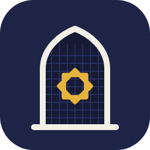
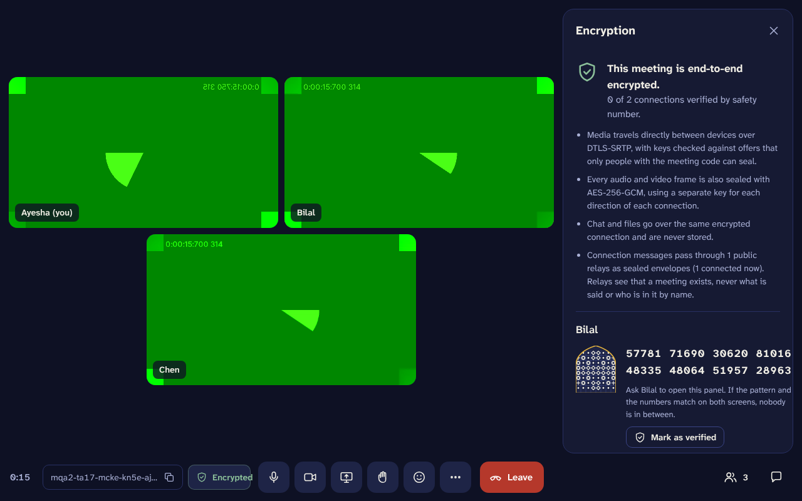
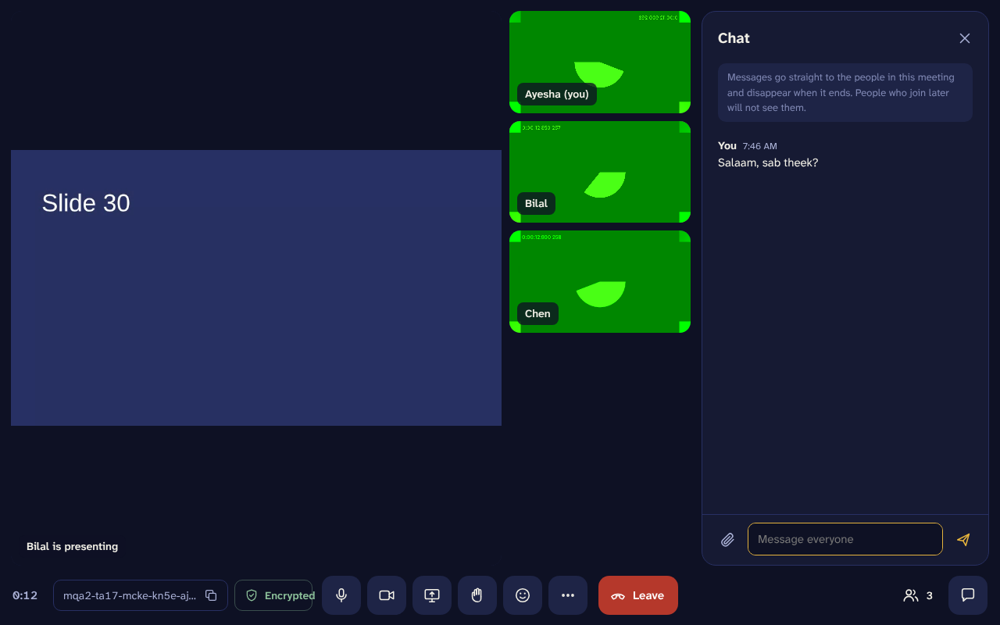
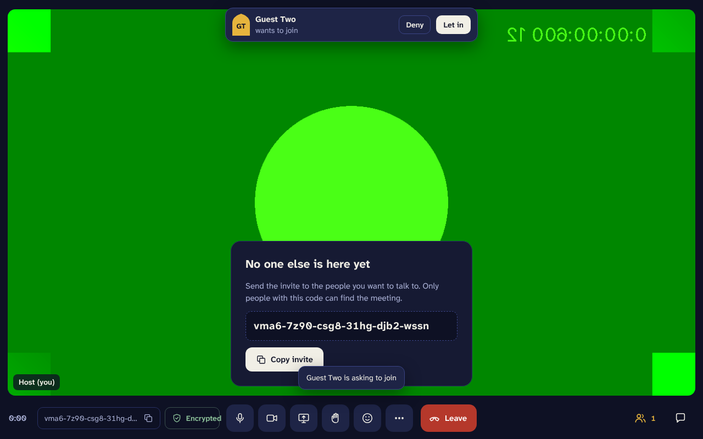

<p align="center"></p>

<h1 align="center">Baithak</h1>

<p align="center">Private video meetings, encrypted from your device to theirs.<br>No accounts. No servers that can listen. Free for non-commercial use.</p>

<p align="center"></p>

A *baithak* is the sitting room in South Asian homes where guests are received, a room you invite people into, with the door shut. This app tries to be that, online.

## What it does

- **Group video calls** for up to 8 people, with screen sharing (including computer sound on Windows).
- **End-to-end encrypted, twice.** WebRTC's DTLS-SRTP on every connection, plus AES-256-GCM on every single audio and video frame, with keys that only exist on the devices in the meeting.
- **No accounts, no sign-up, no history.** Start a meeting, send the code, talk. Chat and files disappear when the meeting ends.
- **No central server.** Devices connect directly. Public relays (or your own) only pass along sealed envelopes so devices can find each other.
- **Verify who you are talking to.** Each connection shows a safety number and a lattice pattern. If both people see the same one, nobody is in the middle.
- **Waiting room, lock, remove, mute.** The host decides who comes in. If the host leaves, the next person becomes host.
- **Chat and file sharing** straight between devices (up to 512 MB per file).
- **Raise hand, reactions, speaking indicator, grid and spotlight views, pin, picture in picture, full screen.**
- **Local recording** that saves only to your device, with a notice shown to everyone while it runs.
- **Optional meeting password**, mixed into every key.
- **Device settings**: microphone, camera, speaker, video quality, noise suppression, echo cancellation.
- **Android extras**: blocks screenshots by default, keeps the call going in the background, speaker or earpiece.
- **Hide your IP address** from other participants by routing through your own TURN server.

| | |
|---|---|
|  |  |
|  |  |

*Screenshots use the browser's built-in test camera, which is why the video is green.*

## Download

| Platform | File | Notes |
|---|---|---|
| Windows 10/11 (64-bit) | `Baithak-Setup-1.0.0.exe` | Installs for your user only, no admin rights needed |
| Windows, no install | `Baithak-1.0.0-portable.exe` | Run from anywhere, e.g. a USB stick |
| Android 8.0+ | `Baithak-1.0.0.apk` | Allow "Install unknown apps" for your browser or file manager |

Get them from the [Releases page](https://github.com/CS-Fasih/E2EE-meeting/releases), or build them yourself (below). The Windows builds are not code-signed, so SmartScreen may warn the first time: choose **More info → Run anyway**.

## How to use it

1. Open Baithak, type your name, and press **Start a meeting**.
2. Press **Copy invite** and send it privately (WhatsApp, Signal, SMS). The code looks like `k7f2-9qxm-3bd0-wv8t-hp4c-ezr6`.
3. The other person opens Baithak, pastes the code or the whole invite under **Have a code?**, and presses **Join**.
4. If the waiting room is on (the default), you will see *"… wants to join"*. Press **Let in**.
5. For sensitive calls, open the shield (**Encrypted**) at the bottom left and compare the safety number with each person by voice. If it matches, press **Mark as verified**.

Keyboard shortcuts on desktop: `Ctrl+D` microphone, `Ctrl+E` camera, `Ctrl+Alt+H` raise hand, `Ctrl+Alt+C` chat, `Ctrl+Alt+P` people, `?` all shortcuts.

## How the privacy works

The short version is in the app under **How it works**. The full design, including exactly what relays and STUN servers can and cannot see, is in [SECURITY.md](SECURITY.md).

```
  your device                                              their device
 ┌─────────────┐   sealed offer/answer (AES-256-GCM)    ┌─────────────┐
 │ meeting code│ ─────────► public relays ────────────► │ meeting code│
 │  → all keys │     (see only an opaque tag)           │  → all keys │
 └─────┬───────┘                                        └──────┬──────┘
       │      DTLS-SRTP  +  per-frame AES-256-GCM             │
       └──────────────── direct, device to device ────────────┘
```

## Run your own relay (optional)

The app works out of the box with public Nostr relays. To use only infrastructure you control:

```bash
# one process: relay + the web version of the app
cd server && npm ci
node relay.js --port 8080 --web ../web/dist
```

Or with Docker, from the repository root:

```bash
docker build -f server/Dockerfile -t baithak .
docker run -p 8080:8080 baithak
```

Put it behind HTTPS (Caddy, nginx, Cloudflare Tunnel), then in the app open **Settings → Network → Relays** and replace the list with `wss://your-domain`. Everyone in a meeting needs at least one relay in common. The relay stores nothing and logs nothing; it only accepts short-lived events and forwards them.

If people are often on mobile data or strict office networks, also add a TURN server (for example [coturn](https://github.com/coturn/coturn)) under **Settings → Network**. Media through TURN stays end-to-end encrypted.

## Build from source

You need Node.js 22. Everything starts from the web app:

```bash
cd web && npm ci && npm run build      # → web/dist
```

**Windows (.exe)** — builds on Windows, Linux or macOS. The installer step needs NSIS (`makensis`; on Ubuntu `sudo apt install nsis`).

```bash
cd desktop && npm ci && npm run dist:win    # → desktop/dist/*.exe
```

**Android (.apk)** — needs JDK 17+ and the Android SDK (platform 35).

```bash
cd android && ./gradlew assembleRelease     # → android/app/build/outputs/apk/release/
```

To sign the APK, create `android/keystore.properties` (never commit it):

```properties
storeFile=/path/to/your-release.jks
storePassword=...
keyAlias=baithak
keyPassword=...
```

**Tests** — three real browsers, a local relay and fake cameras:

```bash
node server/relay.js --port 8787 --web web/dist &
cd tests && npm install && npx playwright install chromium && node e2e.cjs
```

The test checks that video flows between everyone, that every frame is sealed and opened with zero failures, that both ends see the same safety number, plus chat, screen sharing, file transfer, the waiting room and passwords.

## Project layout

```
web/       the app itself (plain JavaScript, no framework), used by every platform
  src/lib/   crypto, relay client, signalling, WebRTC peers, frame encryption, meeting logic
  src/ui/    screens, panels, icons, the jaali safety pattern
server/    optional self-hosted relay (forward-only, stores nothing) + Dockerfile
desktop/   Electron shell for Windows (sandboxed, no Node in the page)
android/   native Android shell (WebView, no third-party libraries)
tests/     end-to-end browser tests
scripts/   icon rendering, installer build, Urdu wordmark generator
```

## Limits, honestly

- Up to 8 people per meeting, because everyone connects to everyone. That is what keeps media off servers.
- Android cannot share its screen: Android's WebView has no screen capture API. Android users can see others' screens.
- Relays and STUN servers can see your IP address. See SECURITY.md for how to reduce this.
- Some networks block direct connections. Without a TURN server, those calls will not connect.
- This is new software and has not had an independent security audit.

## Roman Urdu mein

Baithak ek private video meeting app hai. Koi account nahi chahiye. "Start a meeting" dabayen, code copy karke jinko bulana hai unhein bhejein, wo code paste karke "Join" karein. Awaaz, video, chat aur files aap ke device par hi encrypt hoti hain aur sirf meeting ke logon ke device par khulti hain — beech mein koi server nahi sun sakta. Group call (8 log tak), screen sharing, waiting room, password, chat, file sharing, hand raise aur recording sab mojood hain. Shield wale button par safety number dono taraf match karein to yaqeen ho jata hai ke beech mein koi nahi.

## License

[PolyForm Noncommercial License 1.0.0](LICENSE). You may use, copy, change and share Baithak for any **non-commercial** purpose: personal use, study, research, hobby projects, charities, schools and public institutions. **Commercial use is not allowed** without separate permission from the copyright holder.

Bundled third-party parts keep their own licenses: Atkinson Hyperlegible Next and Noto Nastaliq Urdu (SIL Open Font License 1.1), `@noble/curves` and `@noble/hashes` (MIT), Electron (MIT).
