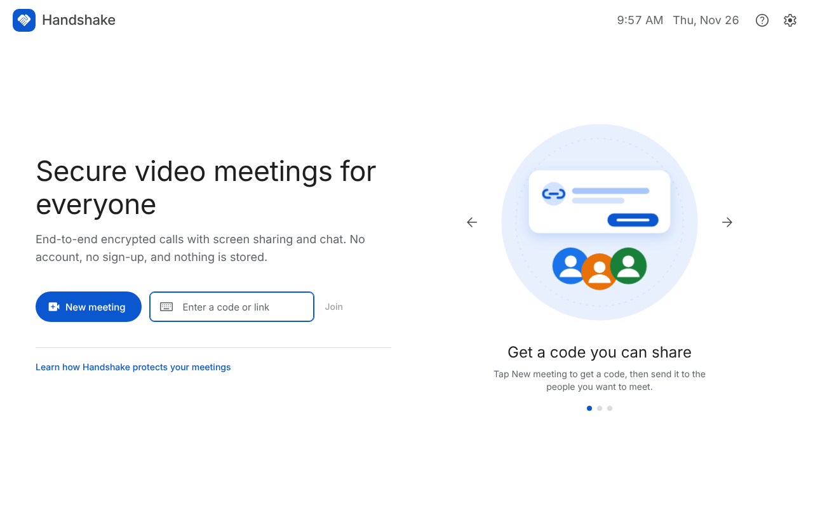
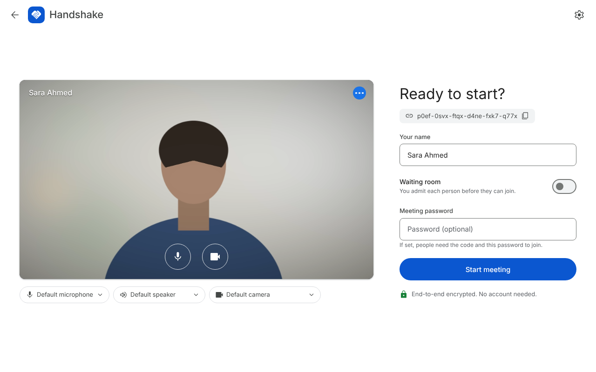
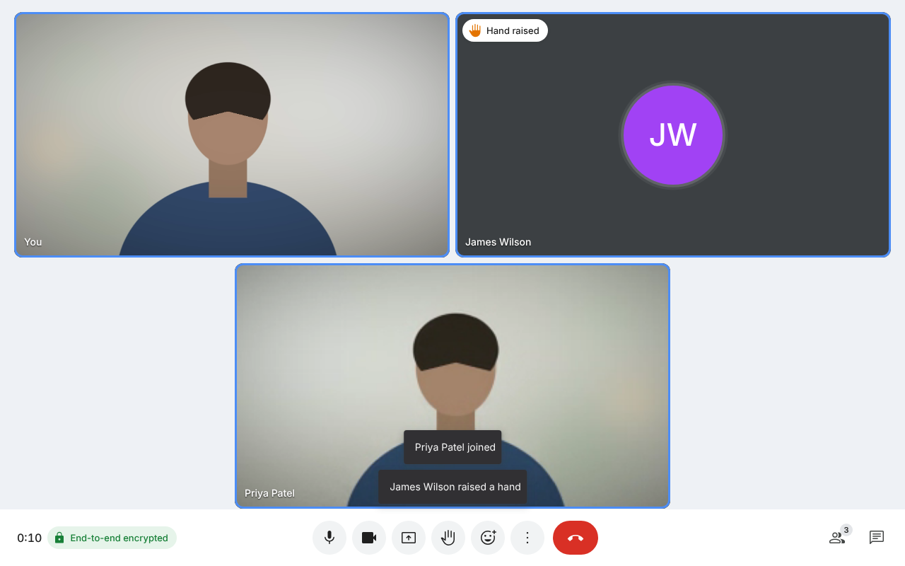
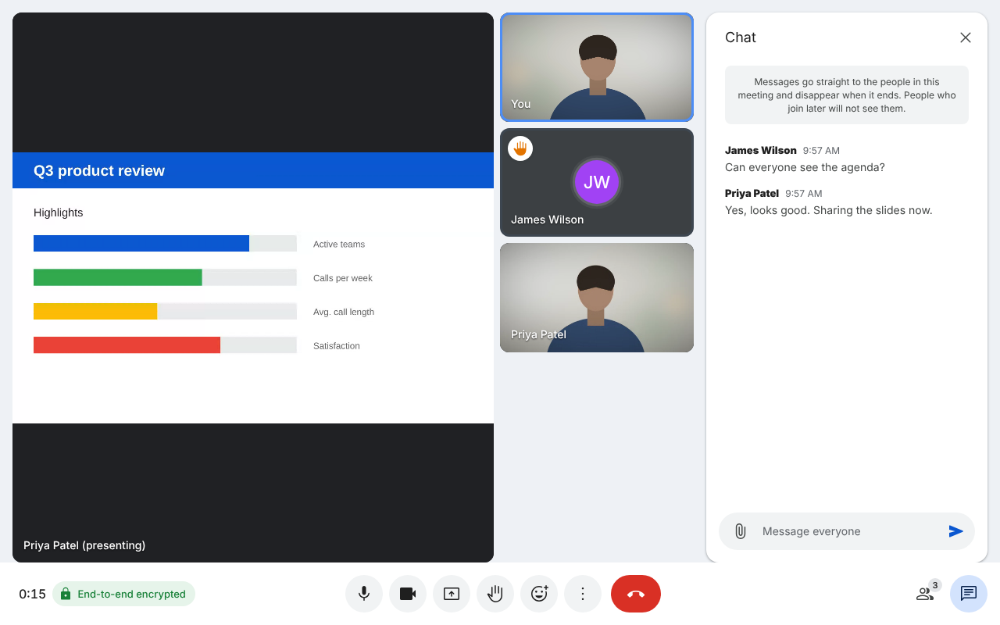
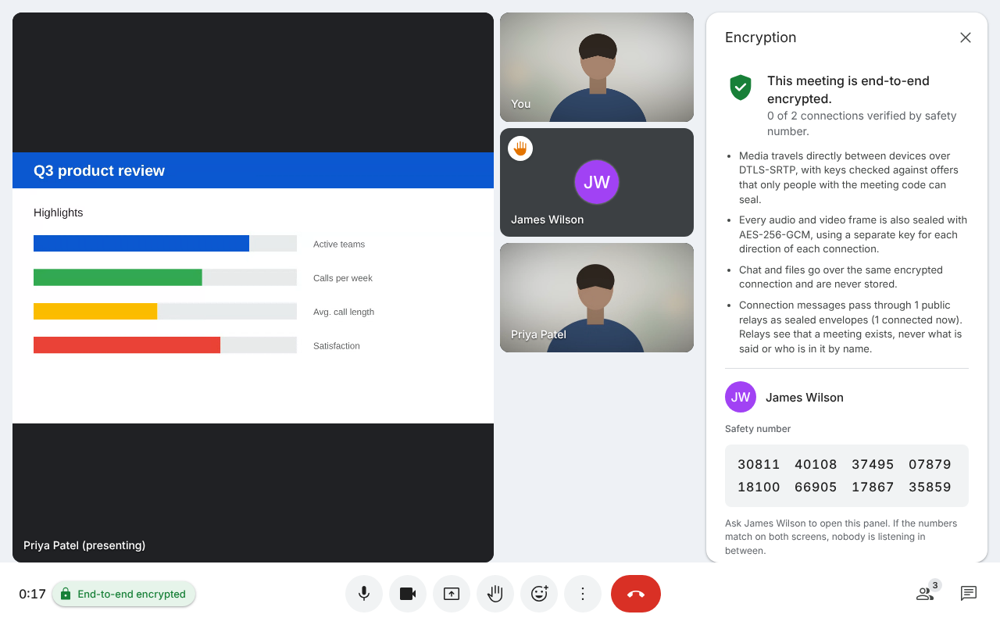
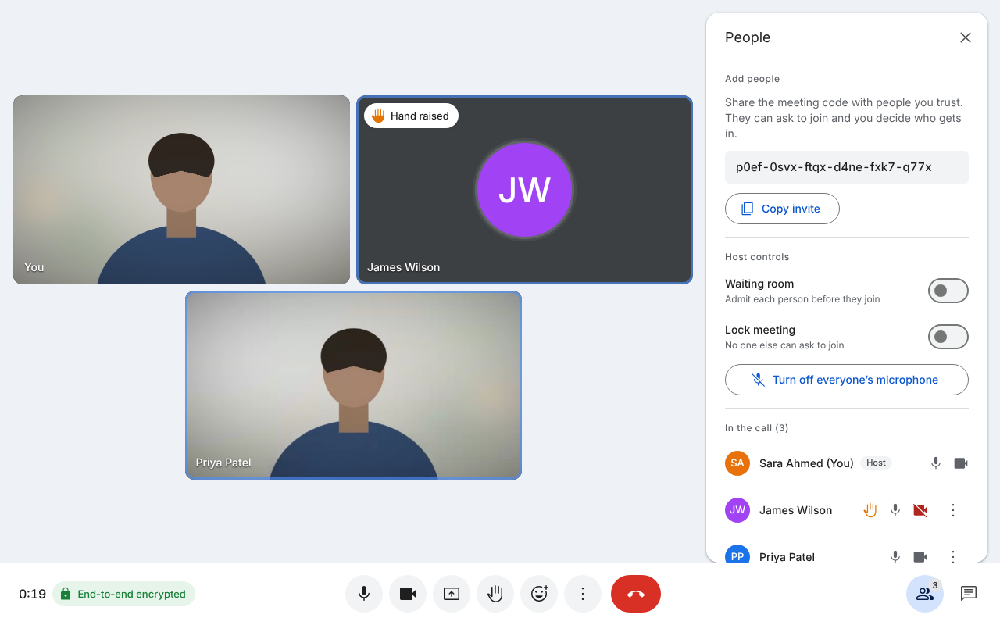
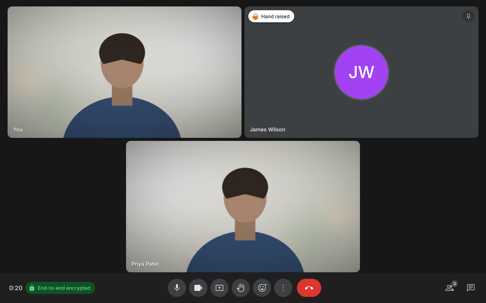
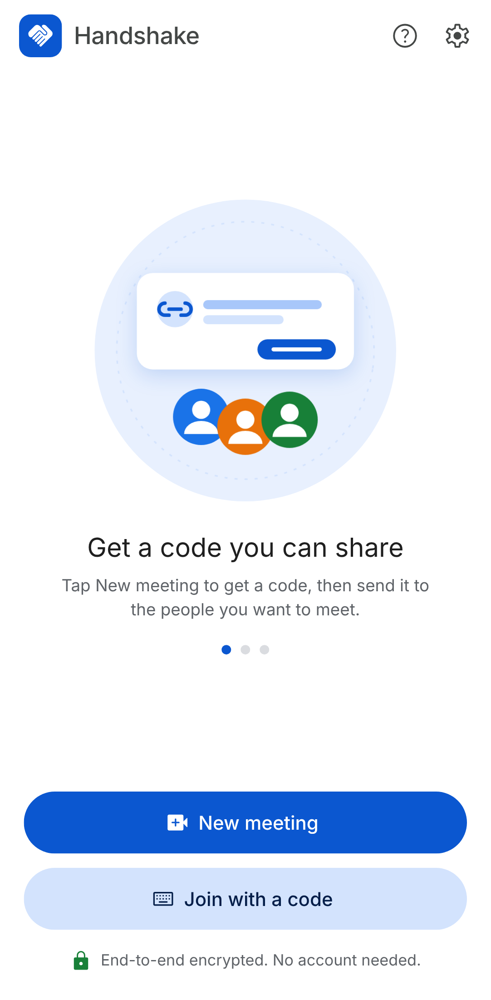
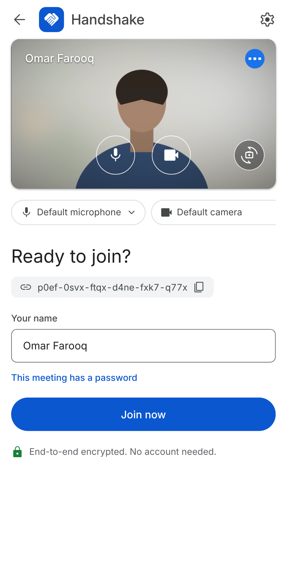
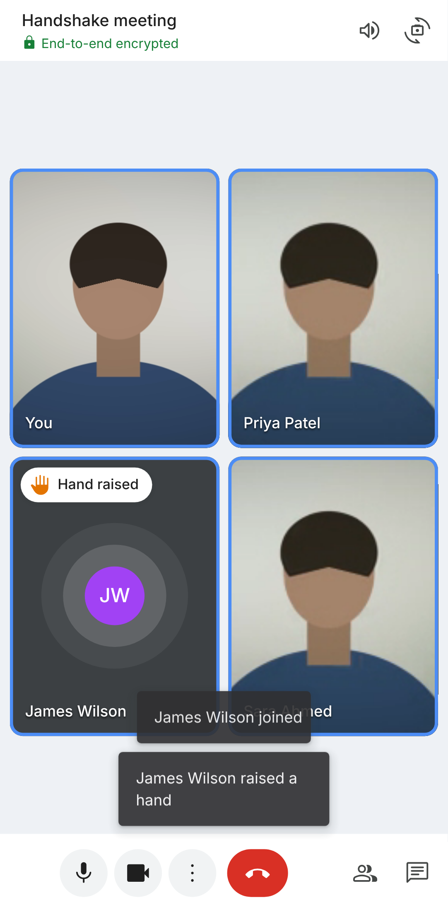

<p align="center"></p>

<h1 align="center">Handshake</h1>

<p align="center">Secure video meetings, end-to-end encrypted.<br>No accounts. No servers that can listen. Free for non-commercial use.</p>

<p align="center"></p>

## Features

- **Group video calls** for up to 8 people, with screen sharing (including system audio on Windows).
- **End-to-end encrypted, twice.** WebRTC's DTLS-SRTP on every connection, plus AES-256-GCM on every audio and video frame, with keys that exist only on the devices in the meeting.
- **No account, no sign-up, no history.** Start a meeting, share the code, talk. Chat and files are gone when the meeting ends.
- **No central server.** Devices connect directly to each other. Relays only pass sealed envelopes so devices can find each other.
- **Verify the connection.** Each connection shows a safety number. If both people see the same number, nobody is in the middle.
- **Host controls:** waiting room, lock meeting, remove participants, turn off microphones. If the host leaves, the next person becomes host.
- **Chat and file sharing** directly between devices (up to 512 MB per file).
- **Raise hand, reactions, active speaker highlight, grid and spotlight layouts, pin, picture-in-picture, full screen.**
- **Local recording** that saves only to your device, with a notice shown to everyone while it runs.
- **Optional meeting password**, mixed into every key.
- **Light and dark themes**, device selection, noise suppression and echo cancellation.
- **Polished motion:** smooth screen transitions, touch ripples, tiles that glide into place as people join and leave, a speaking ring around avatars, bottom sheets you can swipe away on phones.
- **Android:** an app-style phone layout, picture-in-picture during calls, front/back camera switch, haptic feedback, screenshot blocking by default, calls keep running in the background, speaker or earpiece.
- **Hide your IP address** from other participants by routing through your own TURN server.

| | |
|---|---|
|  |  |
|  |  |
|  |  |

<p align="center">&nbsp;&nbsp;&nbsp;&nbsp;</p>

*Screenshots use a synthetic test camera.*

## Download

| Platform | File | Notes |
|---|---|---|
| Windows 10/11 (64-bit) | `Handshake-Setup-1.2.0.exe` | Installs for your user only, no admin rights needed |
| Windows, no install | `Handshake-1.2.0-portable.exe` | Runs from any folder or USB drive |
| Android 8.0+ | `Handshake-1.2.0.apk` | Allow "Install unknown apps" for your browser or file manager |

Get them from the [Releases page](https://github.com/CS-Fasih/E2EE-meeting/releases), or build them yourself (below). The Windows builds are not code-signed, so SmartScreen may warn the first time: choose **More info → Run anyway**.

## How to use it

1. Open Handshake and click **New meeting**.
2. Check your camera and microphone, enter your name and click **Start meeting**.
3. Click **Add others** and send the invite privately (email, WhatsApp, Signal, SMS). The code looks like `k7f2-9qxm-3bd0-wv8t-hp4c-ezr6`.
4. The other person opens Handshake, pastes the code or the invite into **Enter a code or link**, and clicks **Join**, then **Join now**.
5. With the waiting room on (the default), you will see *"… wants to join this call"*. Click **Admit**.
6. For sensitive calls, click **End-to-end encrypted** at the bottom left and compare the safety number with each person by voice. If it matches, click **Mark as verified**.

Keyboard shortcuts on desktop: `Ctrl+D` microphone, `Ctrl+E` camera, `Ctrl+Alt+H` raise hand, `Ctrl+Alt+C` chat, `Ctrl+Alt+P` people, `?` all shortcuts.

## How the privacy works

The short version is in the app under **How it works**. The full design, including exactly what relays and STUN servers can and cannot see, is in [SECURITY.md](SECURITY.md).

```
  your device                                              their device
 ┌─────────────┐   sealed offer/answer (AES-256-GCM)    ┌─────────────┐
 │ meeting code│ ─────────► public relays ────────────► │ meeting code│
 │  → all keys │     (see only an opaque tag)           │  → all keys │
 └─────┬───────┘                                        └──────┬──────┘
       │      DTLS-SRTP  +  per-frame AES-256-GCM             │
       └──────────────── direct, device to device ────────────┘
```

## Run your own relay (optional)

The app works out of the box with public Nostr relays. To use only infrastructure you control:

```bash
# one process: relay + the web version of the app
cd server && npm ci
node relay.js --port 8080 --web ../web/dist
```

Or with Docker, from the repository root:

```bash
docker build -f server/Dockerfile -t handshake .
docker run -p 8080:8080 handshake
```

Put it behind HTTPS (Caddy, nginx, Cloudflare Tunnel), then in the app open **Settings → Network → Relays** and replace the list with `wss://your-domain`. Everyone in a meeting needs at least one relay in common. The relay stores nothing and logs nothing; it only accepts short-lived events and forwards them.

If people are often on mobile data or strict office networks, also add a TURN server (for example [coturn](https://github.com/coturn/coturn)) under **Settings → Network**. Media through TURN stays end-to-end encrypted.

## Build from source

You need Node.js 22. Everything starts from the web app:

```bash
cd web && npm ci && npm run build      # → web/dist
```

**Windows (.exe)**: builds on Windows, Linux or macOS. The installer step needs NSIS (`makensis`; on Ubuntu `sudo apt install nsis`).

```bash
cd desktop && npm ci && npm run dist:win    # → desktop/dist/*.exe
```

**Android (.apk)**: needs JDK 17+ and the Android SDK (platform 35).

```bash
cd android && ./gradlew assembleRelease     # → android/app/build/outputs/apk/release/
```

To sign the APK, create `android/keystore.properties` (never commit it):

```properties
storeFile=/path/to/your-release.jks
storePassword=...
keyAlias=handshake
keyPassword=...
```

**Automatic builds**: `.github/workflows/build.yml` runs the browser tests and builds the Windows and Android apps on every push. When you publish a release on GitHub with a `v…` tag (for example `v1.2.0`), the same workflow attaches the `.exe` and `.apk` files to it. To have CI sign the APK with your key (so updates install over earlier versions), add these repository secrets: `ANDROID_KEYSTORE_BASE64` (the output of `base64 -w0 your-release.jks`), `ANDROID_KEYSTORE_PASSWORD`, `ANDROID_KEY_ALIAS` and `ANDROID_KEY_PASSWORD`. Without them, CI signs with a debug key.

**Tests**: three real browsers, a local relay and fake cameras:

```bash
node server/relay.js --port 8787 --web web/dist &
cd tests && npm install && npx playwright install chromium && node e2e.cjs
```

The test checks that video flows between everyone, that every frame is sealed and opened with zero failures, that both ends see the same safety number, plus chat, screen sharing, file transfer, the waiting room and passwords.

## Project layout

```
web/       the app itself (plain JavaScript, no framework), used by every platform
  src/lib/   crypto, relay client, signalling, WebRTC peers, frame encryption, meeting logic
  src/ui/    screens, panels, dialogs, icons
server/    optional self-hosted relay (forward-only, stores nothing) + Dockerfile
desktop/   Electron shell for Windows (sandboxed, no Node.js in the page)
android/   native Android shell (WebView, no third-party libraries)
tests/     end-to-end browser tests
scripts/   icon rendering and installer build
```

## Limits

- Up to 8 people per meeting, because everyone connects to everyone. That is what keeps media off servers.
- Android cannot share its screen: Android's WebView has no screen capture API. Android users can see others' screens.
- Relays and STUN servers can see your IP address. See SECURITY.md for how to reduce this.
- Some networks block direct connections. Without a TURN server, those calls will not connect.
- This software has not had an independent security audit.

## License

[PolyForm Noncommercial License 1.0.0](LICENSE). You may use, copy, change and share Handshake for any **non-commercial** purpose: personal use, study, research, hobby projects, charities, schools and public institutions. **Commercial use is not allowed** without separate permission from the copyright holder.

Bundled third-party parts keep their own licenses: Inter (SIL Open Font License 1.1), Material Symbols (Apache License 2.0), `@noble/curves` and `@noble/hashes` (MIT), Electron (MIT). Full texts are in `web/public/third-party-licenses.txt`.
